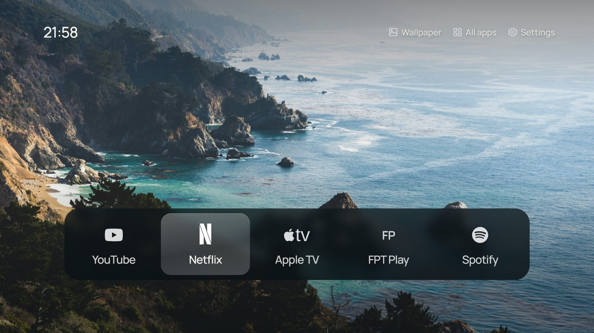

# Tizen 3.0 Clean Launcher

**Project page (Tiếng Việt / English): https://drak905.github.io/Tizen3-Clean-Launcher/**

A quiet, [CleanFrame](https://github.com/nthnclrk/CleanFrame)-style home screen for a **2017 Samsung Smart TV on Tizen 3.0**, plus the SDB tooling, signing workflow and tests used to build and install it. Written for the next human *or coding agent* working on such a TV. MIT licensed (see [LICENSE](LICENSE); third-party assets keep their own terms, see [NOTICE.md](NOTICE.md)).



| | |
|---|---|
| Tested TV | Samsung `UA43M5503AKXXV` (43" FHD), model group `17_KANTS_FHD`, **Tizen 3.0**, ARMv7 |
| Browser engine | **WebKit 538** (`Mozilla/5.0 (SMART-TV; LINUX; Tizen 3.0) AppleWebKit/538.1 … TV Safari/538.1`), roughly Safari 8 |
| Network | TV and a Windows PC on the same LAN. TV ports: SDB `:26101`, REST `:8001`, DIAL `:8080`. The PC's IP must equal the TV's Developer Mode "Host PC IP" |
| App | package `AppleTVDoc`, app id `AppleTVDoc.AppleTVDock`, shown as **AppleTVDock**, version in `launcher/config.xml` |
| Status | In daily use on one TV. Other 2017–2018 Tizen 3.0 models are untested |

## What it does

- Full-screen photo (15 CleanFrame wallpapers) with CleanFrame's top shade and bottom scrim.
- 24-hour clock, top left (`21:05`, `07:03`).
- Quiet controls, top right: **Wallpaper** (next photo, remembered), **All apps** (Samsung app list), **Settings** (TV settings overlay). The focused control sits on a frosted lens.
- Frosted glass dock: **YouTube, Netflix, Apple TV, FPT Play, Spotify**. The focused tile gets CleanFrame's light plate; the dock auto-sizes (≤5 apps centred, >5 full width and scrolling).
- Remote: Left/Right move · Up/Down switch dock ↔ controls · OK opens · Return goes back to the dock (never leaves Home) · Yellow = next wallpaper · Red = on-screen diagnostic log.
- Brings itself back to the front when an app opened from the dock closes (Apple TV and FPT Play otherwise drop to Samsung's screen).
- Ads and tracking are reduced by DNS and TV settings only. **No preinstalled package was ever uninstalled**; the app list is checked against the baseline backup.

## Repository layout

```
launcher/                 the Tizen web app (this is what gets packaged and signed)
  config.xml              Tizen manifest: id, privileges, background-support="enable"
  index.html  css/  js/   UI (ES5 only, see "Platform constraints")
  js/config.js            ← the dock apps and top-right controls (edit here)
  js/app.js               navigation, launching, return-to-Home watcher, diagnostics
  assets/                 wallpapers, pre-rendered glass, icons, Manrope TTFs, catalog.js (generated)
  icon.png                512x423 app icon (generated by scripts/make_icon.py)
  licenses/               CleanFrame MIT, OFL, CC0, photo/icon source records
scripts/
  deploy.ps1              package + sign + install-permit + install + launch   ← daily driver
  debug.ps1               relaunch with web inspector, forward port, sets $env:CDP_PORT
  cdp.js                  tiny DevTools client: node scripts/cdp.js "<js expr>" ...
  import_cleanframe_assets.py   re-import assets from a CleanFrame checkout (crops, fonts, licences)
  make_icon.py            draws launcher/icon.png
  backup_tv.ps1           baseline snapshot of the TV (run once, before any change)
  export_public.ps1       build the public mirror from the private working copy (maintainer)
  restore_tv.ps1          rollback: verify backups, uninstall AppleTVDoc, diff app list (-DryRun supported)
  ssdp_probe.py           find the TV on the LAN
  03_classify_apps.py     Phase-3 app classification → config/user_policy.json
tests/
  test_05_launcher.spec.js   Playwright: UI, navigation, launching, watcher, 24h clock, ES5 guard (no TV needed)
  test_0*.py              pytest: discovery, backups, policy, DNS/no-uninstall, sideload, restore (most need the TV)
backups/                  YOUR baseline snapshot + SHA-256 manifest (git-ignored: it identifies your TV and Wi-Fi)
config/                   ad-domain blocklist, must-resolve allowlist, user_policy.json
docs/                     GitHub Pages site (index.html, Vietnamese default + English)
tools/                    put sdb.exe here (not committed)
```

## Setup on a new PC (Windows)

1. **Developer Mode on the TV:** Home → Apps → press `1 2 3 4 5` → Developer Mode **On**, Host PC IP = this PC → unplug the TV for 15 s. Check: `curl http://<TV_IP>:8001/api/v2/` shows `"developerMode":"1"` and your IP as `developerIP`.
2. **sdb:** download `http://download.tizen.org/sdk/tizenstudio/official/binary/sdb_4.2.36_windows-64.zip` and copy `data/tools/sdb.exe` to `tools/`.
3. **Tizen CLI SDK** (no admin needed): download `https://download.tizen.org/sdk/Installer/tizen-sdk_10.0/web-cli_Tizen_SDK_10.0_windows-64.exe`, then in PowerShell:
   `$env:__COMPAT_LAYER='RunAsInvoker'; .\web-cli_Tizen_SDK_10.0_windows-64.exe --accept-license $env:USERPROFILE\tizen-studio`
   (Without `RunAsInvoker` it demands UAC elevation. It also waits for Enter at the end.)
4. **Node 22+, Python 3.10+**, then `npm install` and `npx playwright install chromium`. Python needs `pytest`, `Pillow`, `fonttools` (+`brotli`) for the scripts.

### Signing (needed once per year)

Retail Samsung TVs only install packages signed with a **Samsung** certificate that lists the TV's DUID. The working route was Samsung's open-source cert tool:

```powershell
git clone https://github.com/Samsung/tizen-agent-skills $env:USERPROFILE\tizen-agent-skills
git -C $env:USERPROFILE\tizen-agent-skills checkout 06f07eca4ce44985be1c2944d58466a82eb15692
cd $env:USERPROFILE\tizen-agent-skills\tizen-sdk-skills
$env:PATH = 'C:\Program Files\Git\usr\bin;' + $env:PATH          # the tool needs openssl.exe; Git ships one
node common\lib\cli\sdk-init-cli.js $env:USERPROFILE\tizen-studio
.\..\..\tools\sdb.exe -s <TV_IP>:26101 shell 0 getduid             # the TV's DUID
node common\lib\cli\cert-manager-cli.js generate-samsung-author --profile-name appletv --identity AppleTVDock --country VN --password-file <pw-file>
#   ^ opens a Samsung Account sign-in in the browser (5 min window). A HUMAN must log in.
node common\lib\cli\cert-manager-cli.js generate-samsung-distributor --profile-name appletv --duid-list <DUID> --privilege Public --password-file <pw-file>
node common\lib\cli\cert-manager-cli.js create-samsung-profile --profile-name appletv --password-file <pw-file>
tizen cli-config "profiles.path=$env:USERPROFILE\tizen-studio-data\profile\profiles.xml"
```

`<pw-file>` contains one line `TIZEN_CERTIFICATE_PASSWORD=<password>`; keep it outside the repo (e.g. `%USERPROFILE%\.tizen-secrets\`). The certificates land in `%USERPROFILE%\tizen-studio-data\keystore\samsung\<profile>\`. `--country` is your 2-letter country code. **None of this is in the repo; never commit it.** Back up `author.p12` and the password: in-place updates must be signed with the same author certificate, otherwise uninstall first.
The certificates are valid for **one year**. Renew and reinstall before they expire; what the TV does with an expired developer app is unverified.

## Daily workflow

```powershell
$env:TV_IP = '<TV_IP>'; $env:PC_IP = '<PC_IP>'   # the scripts and device tests read these
.\scripts\backup_tv.ps1      # ONCE, before the first change: baseline in backups/
npm test                      # Playwright, browser only, ~30 s. Must pass before deploying.
.\scripts\deploy.ps1          # package, sign, install-permit, install, open on the TV
.\scripts\debug.ps1           # optional: live inspector on the TV
node scripts\cdp.js "JSON.parse(localStorage.diag).slice(-20).join('\n')"   # read the launcher's own log
python -m pytest tests -q     # device checks (skip themselves without TV_IP / a baseline)
```

- Change dock apps in `launcher/js/config.js`. App IDs come from `sdb shell 0 vd_applist` (`app_tizen_id`); `tests/test_05_launcher.spec.js` checks every ID against your `backups/applist_baseline.txt` (skipped if you have none).
- The launcher writes every key, launch and visibility change to `localStorage.diag` (last 200 entries). Press **Red** on the remote to see the last 12 on screen. This log is how every TV-side bug here was found.
- **You cannot see the TV.** `Page.captureScreenshot` isn't supported and retail firmware blocks framebuffer access. Verify layout in Playwright, verify behaviour through `diag`/CDP, and ask a person to look at the screen. Don't claim a visual result from the TV without that.

## Platform constraints and findings (read before changing code)

**Runtime (WebKit 538):**
- No CSS custom properties (`var(--x)` computes to 0), no flex `gap`, no `inset`, no `backdrop-filter`. Flexbox, `calc()`, `-webkit-mask-image`, `translate3d`, `object-fit` work. `npm test` fails the build if `var(--`, `gap:`, `inset:` or `backdrop-filter` appear in the CSS.
- JS: ES5. `let`/`const` only parse in strict mode; no arrow functions or template strings (also enforced by a test). Promises exist, but DevTools `awaitPromise` doesn't. Store results in globals and read them in a second `cdp.js` call.
- Fonts: no WOFF2, no variable fonts, and the 2017 font sanitiser (OTS) rejects modern `glyf` overlap flags ("OTS parsing error: glyf"). `import_cleanframe_assets.py` makes static Manrope 500/600 TTFs with those flags cleared and hinting dropped.
- Glass is **pre-rendered** (CleanFrame's `*-study-soft.jpg` for the dock and `*-field-blur.jpg` for the lens), positioned at `-x,-y` inside clipped boxes. Wallpapers are pre-cropped to 1920x1080 so the glass lines up.

**Installing:**
- Unsigned or Tizen-developer-signed packages are rejected. `sdb install` just prints `closed`. Use `tizen install`, and run **`tizen install-permit` first**, or install fails with `install failed[118]`.
- `tizen package` writes the `.wgt` beside the CLI (`tizen-studio\tools\ide\bin\build\`), not to `-o`, and drops `author-signature.xml`/`signature1.xml` into `launcher/` (git-ignored). `deploy.ps1` handles both.
- Partner-level privileges are impossible with the free Public certificate. Adding `appmanager.kill` makes install fail (118), so the launcher **cannot close other apps**. `sdb shell 0 kill <pkgid>` from the PC can.

**Launching apps:**
- `tizen.application.launch(id)` reports success but **does not raise an app already running in the background**. Use `launchAppControl` with `http://tizen.org/appcontrol/operation/default`; `launch()` is the fallback. `openApp()` also retries after 4 s if the launcher is still visible, then shows an error.
- Netflix must be **`org.tizen.netflix-app`**. The Smart Hub entry `RN1MCdNq8t.Netflix` starts but stays invisible (black screen).
- The remote often sends OK twice, so launches are debounced to one per 2.5 s.
- **Exit** cannot be intercepted (Samsung policy). **Return** (`10009`, plus `tizenhwkey` "back") is handled and never leaves Home.
- Apple TV and FPT Play **terminate** on exit and the TV then shows its own screen. `watchApp()` polls `getAppsContext()` every 1.5 s and brings Home back when the watched app disappears while Home is hidden. It stops watching if Home comes back by itself or another user app starts; same-package `*Service`/daemon processes are ignored. This only works because `background-support="enable"`: with it off, timers freeze while hidden (2 ticks in 12 s). There is no `addAppStatusChangeListener` on 3.0.
- Settings (`org.tizen.menu`) opens **over** the launcher (launcher stays "visible"), so it is launched with `watch: false`. All apps = `org.volt.apps`.
- The REST API's `"visible"` flag (`:8001/api/v2/applications/<id>`) is unreliable on this TV; don't build on it.

**Debugging:**
- `sdb shell 0 debug AppleTVDoc.AppleTVDock` often answers `closed`. Appending any extra argument (`… 300`) makes it work. It prints `port: N`; then `sdb forward tcp:N tcp:N` and use `http://127.0.0.1:N/json`. `debug.ps1` does all this.
- `sdb capability`: `intershell_support:disabled`, `filesync_support:push` (no pull), `rootonoff_support:disabled`.
- The local remote-control WebSocket (`:8001/api/v2/channels/samsung.remote.control`) needs an on-TV "Allow" prompt that was never accepted, so you can't press remote keys from the PC. Test keys with synthetic `keydown` events via CDP, or ask a person with the remote.

**Network / ads:**
- The DNS tests default to AdGuard `94.140.14.14`; set `DNS_SERVER` to test your router or Pi-hole instead. Some routers already filter Samsung's ad domains but answer slowly for everything else. A VPN on the PC can skew the results.
- Ad and ACR blocking is DNS-based and reversible (`config/ad_domains_blocklist.txt`); `config/safe_domains_allowlist.txt` must keep resolving.

## Start-up and Home button

- No app can take over the physical **Home** button on this TV; it always opens Smart Hub.
- The supported way to boot into the launcher: Settings → General → Smart Features → **Autorun Last App: On**, **Autorun Smart Hub: Off**, and have the launcher in front when switching off. The return-to-Home watcher makes that the usual case.
- CleanFrame's "native Home" reassignment (Tizen 9) was reviewed and **not attempted**. It relies on an undocumented command-execution workaround in the SDB installer plus a .NET helper that writes `vconf` keys; this TV has no .NET runtime and different firmware. Treat it as high-risk and needing the TV owner's explicit authorisation, a compatibility check and an exact-value rollback first.

## Tests

| File | Needs TV | Covers |
|---|---|---|
| `tests/test_05_launcher.spec.js` | no | layout, 5 tiles centred, icons load, glass applied, D-pad, launch via app control, OK debounce, controls/lens, Return, app IDs exist, ES5/CSS guard, return-to-Home watcher (3 scenarios), 24-hour clock |
| `test_01_discovery.py` | yes | REST API model/OS, Developer Mode + host IP, SDB connected |
| `test_02_backup.py` | no | your baseline files and SHA-256 manifest; the Smart Hub photo is a **manual** step |
| `test_03_classification.py` | no | `never_uninstall`, nothing queued, dock IDs installed |
| `test_04_debloat.py` | yes | ad/ACR domains blocked, essential domains resolve, no package removed vs baseline (only `AppleTVDoc` added) |
| `test_05_sideload.py` | yes | `AppleTVDoc` installed |
| `test_06_restore.py` | no | `restore_tv.ps1 -DryRun` |

With a TV and baseline: Playwright 9/9, pytest 15 pass + 1 manual skip. On a fresh clone without a TV: Playwright 8 pass + 1 skip, pytest 5 pass + 11 skips.

## Restore / remove

`.\scripts\restore_tv.ps1 -DryRun`, then without `-DryRun`. This verifies backup checksums, uninstalls `AppleTVDoc` and diffs the live app list against `backups/applist_baseline.txt`. It then prints the manual checklist: TV DNS back to automatic, Autorun toggles, privacy toggles, Developer Mode off and power-cycle.

## Known limits and unverified behaviour

- Exit from Apple TV / FPT Play returning Home was verified by terminating the app (`sdb shell 0 kill`), the same end state the TV reports after a real Exit; confirm with your remote.
- Settings (`org.tizen.menu`) is opened as an overlay; check it appears on your model.
- TV-side settings (Viewing Information Services, Interest-Based Ads, DNS, Autorun) can't be read or set over SDB; do them with the remote.
- The app shows as "AppleTVDock" (a name from the first plan). To rename it, change `<name>` in `config.xml` only; keep the package and app id, or it becomes a different app.

## Privacy

Never commit: raw `:8001/api/v2/` output (it contains the TV's Wi-Fi MAC, your router's BSSID and device UUIDs), the DUID (`sdb shell 0 getduid`), certificates (`*.p12`, `device-profile.xml`), password files, or your LAN addresses. `backups/`, signing material and `tools/*.exe` are git-ignored.

## Credits and licences

The look, wallpapers, glass materials, brand icons and font come from **[CleanFrame](https://github.com/nthnclrk/CleanFrame)** by Nathan Clark (MIT). Photos are under the Unsplash License, brand icons from Simple Icons are CC0, and Manrope is under the SIL OFL. See `launcher/licenses/`. Brand marks belong to their owners. The globe/TV outline icons and the app icon are original. The workflow also drew on [Glass Home](https://github.com/victaphu/glass-home-samsung-tv) (Netflix ID, app-control launching, signing steps) and Samsung's [tizen-agent-skills](https://github.com/Samsung/tizen-agent-skills). This project has no affiliation with Samsung, Apple or any streaming service.
